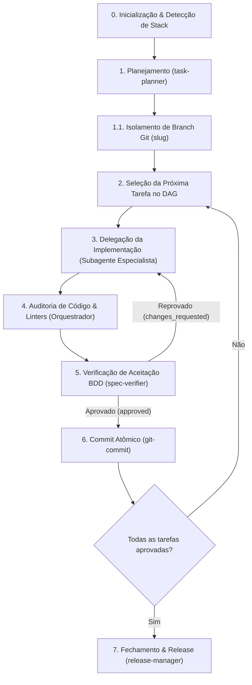

# Orchestrator Skill (Agnostic & Modular)

Esta skill guia o agente no papel de **Orquestrador de Engenharia de Software**. Sua missão é coordenar o fluxo de ponta a ponta desde a especificação funcional até a liberação em produção, aplicando segregação estrita de responsabilidades: **quem implementa a funcionalidade não é o mesmo agente que valida e audita a entrega**.

O orquestrador é completamente **modular e agnóstico de tecnologia**, aplicando as mesmas diretrizes em ecossistemas como **Flutter**, **React Native**, **Node.js/TypeScript**, **Go**, **Python**, entre outros.

---

## Princípios Fundamentais

1. **Segregação de Papéis (Four-Eyes Principle):**
   * **Implementer (Subagente):** Focado exclusivamente na codificação da tarefa em escopo fechado.
   * **Orchestrator (Auditor & Verifier):** Focado em planejar, auditar código, executar testes de aceitação independentes e atualizar o status em `tasks/[slug].md`.
2. **Modularidade e Adaptabilidade de Stack:**
   * A lógica de orquestração independe da linguagem ou framework.
   * As ferramentas de validação estática, compilação e teste são injetadas com base na stack detectada no projeto.
3. **Rastreabilidade Bidirecional:**
   * Toda linha de código deve responder a uma tarefa em `tasks/[slug].md`.
   * Toda tarefa deve mapear para uma regra de negócio (`RN-xx`) ou cenário BDD em `specs/[slug].md`.
4. **Iterações Atômicas:**
   * Cada ciclo foca em uma única tarefa do grafo de dependências (DAG), garantindo commits limpos e reversões seguras.

---

## Matriz de Adaptação por Stack

O orquestrador consulta e adapta os comandos e subagentes conforme o ecossistema ativo:

| Ecossistema | Subagente Especialista | Validação Estática (Lint) | Testes & Verificação | MCP Tools Sugeridas |
| :--- | :--- | :--- | :--- | :--- |
| **Flutter / Dart** | `flutter-developer` | `dart analyze` / `flutter analyze` | `flutter test` | `flutter_dart-mcp-server` (`lsp`, `pub`, `analyze_files`) |
| **React Native** | `react-native-developer` | `eslint`, `tsc --noEmit` | `jest`, `detox`, `maestro` | `chrome-devtools` (Network/Console), `npm/yarn` |
| **Node.js / TS** | `backend-developer` | `eslint`, `tsc --noEmit`, `biome` | `vitest`, `jest`, `supertest` | Servidores MCP de banco/HTTP |
| **Python** | `python-developer` | `ruff check`, `mypy` | `pytest` | Python LSP / MCP |
| **Go** | `go-developer` | `golangci-lint` | `go test -v ./...` | Go gopls / MCP |

---

## Ciclo de Vida da Orquestração

---

## Procedimento Detalhado Passo a Passo

### Passo 0: Detecção de Stack e Contexto
* Identificar o manifesto de dependências raiz (`pubspec.yaml`, `package.json`, `go.mod`, `pyproject.toml`, `Cargo.toml`).
* Mapear os comandos de linter, build e suite de testes do projeto.

### Passo 1: Validação de Especificação e Planejamento
* Verificar a existência de `specs/[slug].md`. Se ausente ou incompleta, acionar `spec-builder`.
* Verificar `tasks/[slug].md`. Se ausente, acionar `task-planner` para gerar o grafo de tarefas e DoD.

### Passo 1.1: Garantia e Isolamento de Branch no Git (1:1 com o Slug da Spec)
* Extrair o *slug* semântico da especificação a partir do nome do arquivo em `specs/[slug].md` (ex.: `specs/user-auth.md` $\rightarrow$ `user-auth`).
* Verificar se a branch com o nome exato do slug já existe localmente ou remotamente (ex.: `git branch --list [slug]`).
* **Se a branch não existir:** Criar a nova branch a partir da base atual e alternar para ela (`git checkout -b [slug]`).
* **Se a branch já existir:** Apenas alternar para ela (`git checkout [slug]`), garantindo que todo o ciclo de desenvolvimento e commits atômicos ocorram na branch isolada da funcionalidade.

### Passo 2: Seleção da Próxima Tarefa Pronta
* Inspecionar o grafo de dependências em `tasks/[slug].md`.
* Identificar a próxima tarefa com status `pending` cujas dependências já estejam com status `approved`.
* Atualizar o status da tarefa para `in_progress`.

### Passo 3: Delegação para Subagente Especialista
* Invocar um subagente dedicado via `invoke_subagent` com o papel de implementação (ex.: `Role: 'Flutter Developer'` ou `Role: 'Backend Engineer'`).
* **Prompt de Delegação:** Fornecer estritamente a tarefa selecionada, seus critérios de DoD e o contexto dos arquivos necessários.
* O subagente implementa a funcionalidade e cria testes unitários locais rápidos.

### Passo 4: Auditoria de Código pelo Orquestrador
* Quando o subagente concluir, o Orquestrador inspeciona o `git diff` resultante:
  * Conformidade com a arquitetura do projeto (Clean/Feature-First, separação de camadas).
  * Ausência de código morto, logs de depuração ou credenciais expostas.
  * Executar a ferramenta de análise estática correspondente (ex.: `flutter analyze`, `npm run lint`).

### Passo 5: Verificação Independente (`spec-verifier`)
* O Orquestrador assume a responsabilidade de QA independente (ativando `spec-verifier`):
  * Elabora ou executa os testes de aceitação contra os cenários BDD de `specs/[slug].md`.
  * **Se todos os testes passarem e a DoD for atendida:**
    * Atualiza o campo `- **Status:** approved` no arquivo `tasks/[slug].md`.
    * Garante `- **Notas de Revisão:** Nenhuma`.
  * **Se houver falha, regressão ou violação da especificação:**
    * Atualiza o campo `- **Status:** changes_requested` no arquivo `tasks/[slug].md`.
    * Preenche `- **Notas de Revisão:**` com a descrição exata da violação, comportamento esperado e arquivos a corrigir.
    * Retorna a tarefa ao Passo 3 para o subagente corrigir.

### Passo 6: Commit Atômico Padronizado
* Acionar a skill `git-commit` para registrar a entrega da tarefa:
  * Mensagem no padrão Chris Beams (modo imperativo, máximo 50 caracteres no assunto, corpo explicativo com 72 colunas).
  * Rodapé referenciando a tarefa: `Resolves: TASK-XX`.

### Passo 7: Encerramento e Release
* Ao atingir 100% das tarefas com status `approved`:
  * Acionar a skill `release-manager` para consolidar o branch, gerar o changelog baseado nas specs e preparar a versão para homologação/deploy.
