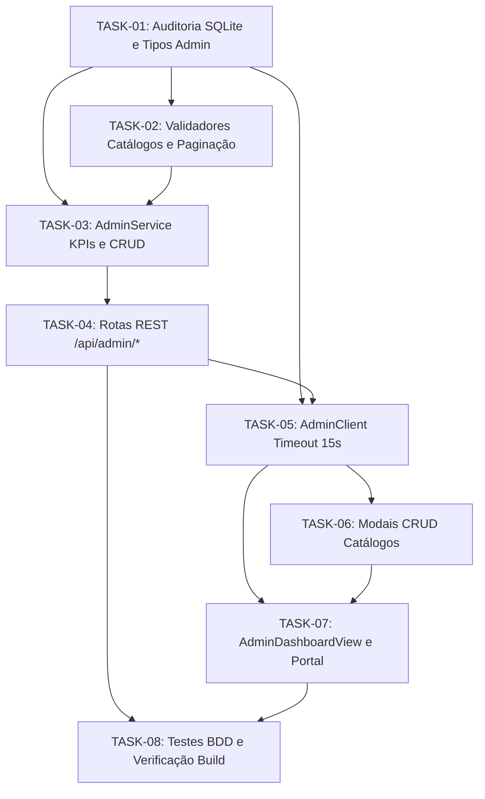

# Dashboard do Administrador (Métricas e Gestão de Catálogos) - Plano Técnico de Tarefas

- **Especificação:** `specs/admin-dashboard.md`
- **Status Geral:** `pending`

## Grafo de Dependências

---

## Contexto Arquitetural do Repositório

- **Backend existente:** Node.js 24 ESM em `server/index.mjs` com autenticação JWT/RBAC (`server/auth/`) e tabelas SQLite de veículos e serviços (`catalog_vehicles`, `catalog_services`, `user_vehicles`, `maintenance_logs`) já criadas em `server/dashboard/db.mjs`. As rotas administrativas devem viver em `server/admin/` e exigir `authenticateRequest` + `requireRole("admin")` em **100%** dos endpoints `/api/admin/*`, mantendo `GET /api/admin/health` intacto para os testes de `auth-roles`.
- **Frontend existente:** Expo 54 + React Native Web com `RoleGuard requiredRole="admin"` e `AdminPortalShell.tsx` já conectados ao fluxo de login de administradores (`adm@email.com`). O novo painel administrativo substituirá os cards estáticos do `AdminPortalShell.tsx` por dados reais em tempo real e gestão completa dos catálogos.

---

## Tarefas de Engenharia

### [TASK-01] Migração idempotente de auditoria no SQLite e tipagens compartilhadas do Admin
- **Camada:** `data_model`
- **Status:** `approved`
- **Depende de:** `Nenhuma`
- **Definição de Conclusão (DoD):**
  - Atualizar `server/dashboard/db.mjs` para adicionar de forma idempotente (via verificação `PRAGMA table_info(...)` + `ALTER TABLE ... ADD COLUMN` quando ausente, garantindo compatibilidade com bancos `./data/torquelab.sqlite` já existentes):
    - Coluna `updated_by TEXT REFERENCES users(id)` em `catalog_vehicles` e `catalog_services` (`RN-03`).
    - Índice único/auxiliar para acelerar filtros por marca/categoria em `user_vehicles(brand, category, deleted_at)`.
  - Criar `lib/admin/types.ts` com tipagens estritas:
    - `PaginationMeta` (`page`, `limit`, `total`, `totalPages`)
    - `AdminOverviewResponse` (`users: { total, active, newLast30Days, adminCount }`, `catalogVehicles: { total, active, inactive }`, `userVehicles: { total, averagePerActiveUser }`, `catalogServices: { total, active, inactive }`, `generatedAt`)
    - `AdminUserVehicleItem` (marca, modelo, ano, km atual, categoria, combustível, apelido, `ownerName`, `ownerEmailMasked`, `createdAt`)
    - `AdminTopModelItem` (`brand`, `model`, `count`)
    - `AdminUserVehiclesResponse` (`items`, `pagination`, `topModels`)
    - `AdminCatalogVehicle` (com `updatedBy`, `createdAt`, `updatedAt`) e `AdminCatalogVehiclesResponse`
    - `AdminCatalogService` (com `updatedBy`, `createdAt`, `updatedAt`) e `AdminCatalogServicesResponse`
    - Payloads `CreateCatalogVehiclePayload`, `UpdateCatalogVehiclePayload`, `CreateCatalogServicePayload`, `UpdateCatalogServicePayload`.
- **Notas de Revisão:** Nenhuma

### [TASK-02] Validadores estritos dos catálogos e paginação administrativa
- **Camada:** `service`
- **Status:** `approved`
- **Depende de:** `TASK-01`
- **Definição de Conclusão (DoD):**
  - Criar `server/admin/validators.mjs` cobrindo `RN-01` e `RN-03`:
    - `parsePagination(searchParams)`: impõe `page >= 1` (default `1`) e `limit` inteiro `1..100` (default `20`), rejeitando valores inválidos com `fields`.
    - `validateCreateCatalogVehicle(body)` e `validateUpdateCatalogVehicle(body)`:
      - `brand` e `model`: obrigatórios na criação, 2 a 80 caracteres após `trim()`.
      - `year`: inteiro entre `1950` e `new Date().getFullYear() + 2`.
      - `fuel`: obrigatório (2–40 chars).
      - `category`: obrigatório em `["compact", "medium_suv", "diesel_pickup", "premium", "electric"]`.
      - `costFactor`: número decimal entre `0.50` e `5.00`.
      - `referenceConsumption`: número decimal > `0` e ≤ `100` (default `11.5` ou `6.0` se elétrico).
      - `fipePrice`: string opcional ≤ 40 chars.
      - `active`: booleano opcional (default `true` na criação).
    - `validateCreateCatalogService(body)` e `validateUpdateCatalogService(body)`:
      - `name`: obrigatório na criação, 3 a 100 caracteres após `trim()`.
      - `category`: obrigatório na criação, 2 a 40 caracteres (ex.: `motor`, `freios`, `pneus`, `fluidos`, `elétrica`, `filtros`).
      - `intervalKm`: inteiro entre `1.000` e `300.000`.
      - `intervalMonths`: opcional (`null` permitido); quando informado, inteiro entre `1` e `120`.
      - `baseCost`: número decimal entre `0` e `100.000` (rejeita negativos como `-50`, `Cenário 5`).
      - `combustionOnly`: booleano (default `false`).
      - `notes`: opcional ≤ 240 chars.
      - `active`: booleano opcional.
    - Retorna `{ valid: true, data }` ou `{ valid: false, fields }` pronto para HTTP `400 Bad Request`.
- **Notas de Revisão:** Nenhuma

### [TASK-03] Serviço administrativo de métricas (KPIs), veículos de usuários e CRUD dos catálogos
- **Camada:** `service`
- **Status:** `approved`
- **Depende de:** `TASK-01`, `TASK-02`
- **Definição de Conclusão (DoD):**
  - Criar `server/admin/adminService.mjs` com `AdminError(status, message, options)` e `createAdminService({ db, now = () => Date.now() })`:
    - `maskEmail(email)`: mascara preservando inicial e domínio (ex.: `bruno@exemplo.com` → `b***@exemplo.com`, `RF-02`).
    - `getOverview()` (`RF-01`, `RN-04`, `Cenário 1`):
      - `users`: conta contas `role = 'user'` (`total`, `active`, `newLast30Days`) e separadamente `adminCount` (`role = 'admin'`).
      - `catalogVehicles`: `total`, `active`, `inactive`.
      - `userVehicles`: `total` (`deleted_at IS NULL`) e `averagePerActiveUser` (arredondado para 2 casas decimais, `0` se sem usuários ativos).
      - `catalogServices`: `total`, `active`, `inactive`.
      - `generatedAt`: ISO timestamp atual (`RF-05`).
    - `listUserVehicles({ page, limit, search, brand, category, kmMin, kmMax })` (`RF-02`, `Cenário 4`):
      - Faz JOIN entre `user_vehicles` (`deleted_at IS NULL`) e `users`, aplica filtros e paginação (`RN-03`), mascara e-mail do proprietário e retorna `topModels` (top 5 marcas/modelos mais cadastrados no recorte).
    - `listCatalogVehicles({ page, limit, search, brand, category, status })` (`RF-03`, `RN-03`).
    - `createCatalogVehicle(adminUserId, payload)` (`RF-03`, `RN-01`, `RN-03`):
      - Verifica unicidade normalizada de `(brand, model, year, fuel)` (case-insensitive + trim) → `AdminError(409, "Este veículo já existe no catálogo.")`.
      - Persiste com `updated_by = adminUserId`, `created_at`, `updated_at`.
    - `updateCatalogVehicle(adminUserId, id, payload)` (`RF-03`, `RN-01`, `RN-02`, `RN-03`, `Cenário 3`):
      - Verifica existência (`404`), unicidade da combinação normalizada em caso de alteração (`409`), atualiza campos e/ou `active = 0/1` mantendo integridade referencial dos veículos de usuários vinculados, e grava `updated_by`/`updated_at`.
    - `listCatalogServices({ page, limit, search, category, combustionOnly, status })` (`RF-04`, `RN-03`).
    - `createCatalogService(adminUserId, payload)` (`RF-04`, `RN-01`, `RN-03`, `Cenário 2`, `Cenário 5`):
      - Verifica unicidade case-insensitive de `name` → `AdminError(409, "Já existe um serviço com este nome no catálogo.")`.
      - Persiste com `updated_by = adminUserId`, `created_at`, `updated_at`.
    - `updateCatalogService(adminUserId, id, payload)` (`RF-04`, `RN-01`, `RN-02`, `RN-03`):
      - Verifica existência (`404`), unicidade de `name` (`409`), permite edição de `baseCost`/`intervalKm`/`intervalMonths`/`active` sem jamais alterar registros já gravados em `maintenance_logs` (`RN-02`), e grava `updated_by`/`updated_at`.
- **Notas de Revisão:** Nenhuma

### [TASK-04] Endpoints REST `/api/admin/*` protegidos por RBAC e integração em `server/index.mjs`
- **Camada:** `api_contract`
- **Status:** `approved`
- **Depende de:** `TASK-03`
- **Definição de Conclusão (DoD):**
  - Criar `server/admin/routes.mjs` exportando `createAdminRouter({ db, getDb, config, now })` exigindo `authenticateRequest` (`401`) + `requireRole(authUser, "admin")` (`403` para `user`, `RN-03`, `Cenário 6`) em todas as rotas `/api/admin/*`:
    - `GET /api/admin/health` → `200 OK` (`{ status: "ok", role: "admin", user }`, mantendo compatibilidade 100% com `server/auth/auth.test.mjs`).
    - `GET /api/admin/overview` → `200 OK` (`Cenário 1`).
    - `GET /api/admin/user-vehicles` → `200 OK` (`Cenário 4`).
    - `GET /api/admin/catalog/vehicles` → `200 OK`.
    - `POST /api/admin/catalog/vehicles` → `201 Created` (`400`, `409`).
    - `PATCH /api/admin/catalog/vehicles/:id` → `200 OK` (`400`, `404`, `409`, `Cenário 3`).
    - `GET /api/admin/catalog/services` → `200 OK`.
    - `POST /api/admin/catalog/services` → `201 Created` (`400`, `409`, `Cenários 2 e 5`).
    - `PATCH /api/admin/catalog/services/:id` → `200 OK` (`400`, `404`, `409`).
    - Bloqueio explícito de exclusão física `DELETE /api/admin/catalog/*` retornando `405 Method Not Allowed` orientando a usar `PATCH` com `active: false` (`RN-02`).
  - Integrar `createAdminRouter` em `server/index.mjs` (delegando o prefixo `/api/admin/*` a `server/admin/routes.mjs` antes de `handleAuthRoute` ou unificando de forma limpa sem quebrar nenhum teste de `auth`, `dashboard` ou `api`).
- **Notas de Revisão:** Nenhuma

### [TASK-05] Cliente HTTP administrativo com timeout de 15 segundos
- **Camada:** `service`
- **Status:** `approved`
- **Depende de:** `TASK-01`, `TASK-04`
- **Definição de Conclusão (DoD):**
  - Criar `lib/admin/adminClient.ts` (puro TypeScript sem imports de React Native, injetável para testes):
    - `AdminClientError(status, message, { fields?, isTimeout?, isNetworkError? })`.
    - Timeout administrativo dedicado de **15 segundos** (`15_000 ms`, `RN-04`) via `AbortController` passado ao `authenticatedFetch`.
    - Métodos: `getOverview()`, `listUserVehicles(query?)`, `listCatalogVehicles(query?)`, `createCatalogVehicle(payload)`, `updateCatalogVehicle(id, payload)`, `listCatalogServices(query?)`, `createCatalogService(payload)`, `updateCatalogService(id, payload)`.
  - Criar `lib/admin/defaultAdminClient.ts` exportando `defaultAdminClient = createAdminClient(defaultAuthClient)`.
- **Notas de Revisão:** Nenhuma

### [TASK-06] Modais de CRUD para Catálogo de Carros e Catálogo de Manutenções
- **Camada:** `ui`
- **Status:** `in_progress`
- **Depende de:** `TASK-05`
- **Definição de Conclusão (DoD):**
  - Criar `components/admin/CatalogVehicleModal.tsx` (criar/editar veículo do catálogo):
    - Campos: marca, modelo, ano, combustível, categoria (`compact`, `medium_suv`, `diesel_pickup`, `premium`, `electric`), fator de custo (`0.50..5.00`), consumo de referência, valor FIPE de referência e status `active`.
    - Validação inline (`RN-01`); em erro `400` ou `409` do servidor, exibe o erro no campo correspondente **mantendo o modal aberto e todos os dados preenchidos intactos** (`RN-04`).
  - Criar `components/admin/CatalogServiceModal.tsx` (criar/editar serviço do catálogo):
    - Campos: nome, categoria (`motor`, `freios`, `pneus`, `fluidos`, `elétrica`, `filtros`), `intervalKm` (`1.000..300.000`), `intervalMonths` opcional (`1..120`), `baseCost` (`0..100.000`), switch/toggle `combustionOnly`, observação técnica e status `active`.
    - Validação inline (`RN-01`); em erro `400` (ex.: `baseCost: -50`) ou `409` (nome duplicado), exibe erro no campo correspondente **sem fechar o modal nem limpar o formulário** (`RN-04`, `Cenário 5`).
- **Notas de Revisão:** Nenhuma

### [TASK-07] Dashboard Administrativo completo com 4 abas, KPIs, filtros e fallback por bloco
- **Camada:** `ui`
- **Status:** `pending`
- **Depende de:** `TASK-05`, `TASK-06`
- **Definição de Conclusão (DoD):**
  - Criar `components/admin/AdminDashboardView.tsx` no tema visual TorqueLab (dark + crimson, mobile-first e responsivo) cobrindo `RF-01`..`RF-05` e `RN-04`:
    - Cabeçalho com saudação do admin, botão **"Atualizar dados"** com timestamp da última sincronização (`RF-05`) e botão **"Abrir Minha Garagem"** (`switchAdminPortal("user")`).
    - **4 cards de KPIs em tempo real (`RF-01`, `Cenário 1`):**
      1. **Usuários cadastrados** (total, ativos, novos 30d + nota de admins separados).
      2. **Carros no catálogo** (total, ativos/inativos).
      3. **Carros de usuários** (total e média por usuário ativo).
      4. **Catálogo de manutenções e serviços** (total ativos/inativos).
    - **4 abas de navegação (`RF-05`):**
      1. **Visão Geral:** resumo operacional, ranking dos modelos mais cadastrados (`topModels`) e atalhos rápidos para criar carro/serviço.
      2. **Catálogo de Carros:** busca, filtros por categoria e status (`Todos`/`Ativos`/`Inativos`), paginação, botão `+ Novo carro`, ações **Editar** e **Ativar/Desativar** (`Cenário 3`).
      3. **Carros de Usuários (somente leitura):** busca, filtros por marca, categoria e faixa de KM (`kmMin`/`kmMax`), paginação e exibição de marca, modelo, ano, km, categoria e proprietário mascarado (`RF-02`, `Cenário 4`).
      4. **Catálogo de Manutenções:** busca, filtros por categoria, combustão e status, paginação, botão `+ Novo serviço`, ações **Editar** e **Ativar/Desativar** (`RF-04`, `Cenários 2 e 5`).
    - **Isolamento de falhas por bloco (`RN-04`):** erro ao carregar os KPIs ou uma aba específica exibe banner localizado com **"Tentar novamente"** sem derrubar as demais abas.
  - Atualizar `components/auth/AdminPortalShell.tsx` para renderizar `<AdminDashboardView />` dentro de `<RoleGuard requiredRole="admin">`.
- **Notas de Revisão:** Nenhuma

### [TASK-08] Testes de aceitação BDD (`spec-verifier`) e validação de build
- **Camada:** `test`
- **Status:** `pending`
- **Depende de:** `TASK-04`, `TASK-07`
- **Definição de Conclusão (DoD):**
  - Criar `server/admin/admin.test.mjs` (`node --test` + SQLite `:memory:`) cobrindo todos os 6 cenários BDD e regras:
    - **Cenário 1:** `GET /api/admin/overview` retorna `200 OK` com contagens exatas de usuários (`user` separado de `admin`), carros no catálogo, carros de usuários e serviços ativos + `generatedAt`.
    - **Cenário 2:** `POST /api/admin/catalog/services` cria `"Troca de fluido de arrefecimento"` (`40000 km`, `24 meses`, `R$ 260`, `combustionOnly: false`) retornando `201`, grava `updatedBy`, incrementa o KPI de serviços e passa a aparecer nos cálculos de `GET /api/dashboard` do usuário!
    - **Cenário 3:** `PATCH /api/admin/catalog/vehicles/:id` com `active: false` desativa veículo do catálogo vinculado a veículos de usuários retornando `200`, removendo de `GET /api/catalog/vehicles` sem afetar os veículos salvos na garagem dos usuários.
    - **Cenário 4:** `GET /api/admin/user-vehicles?brand=Toyota&page=1&limit=10` retorna apenas veículos `Toyota` com e-mail mascarado, paginação e `topModels`.
    - **Cenário 5:** `POST /api/admin/catalog/services` com nome duplicado retorna `409 Conflict` e com `baseCost: -50` retorna `400 Bad Request` com `fields.baseCost`.
    - **Cenário 6:** Usuário `role: "user"` enviando `GET /api/admin/overview` ou `POST /api/admin/catalog/services` recebe `403 Forbidden`; sem token recebe `401 Unauthorized`.
    - **Regras extras (`RN-02`, `RN-03`):** `DELETE /api/admin/catalog/*` retorna `405`; alteração de `baseCost` em serviço não altera `paid_cost`/`estimated_cost` gravados em `maintenance_logs` antigos; paginação limitada a 100.
  - Criar `lib/admin/adminClient.test.ts` validando chamadas do cliente, erros `400`/`403`/`409` e timeout administrativo de 15s.
  - Adicionar script `"test:admin"` em `package.json` e executar `npm run test:admin`, `npm run test:dashboard`, `npm run test:auth`, `npm run test:api`, `npm run test:preventive`, `npx tsc --noEmit`, `npm run lint` e `npm run build` com 0 erros.
- **Notas de Revisão:** Nenhuma
