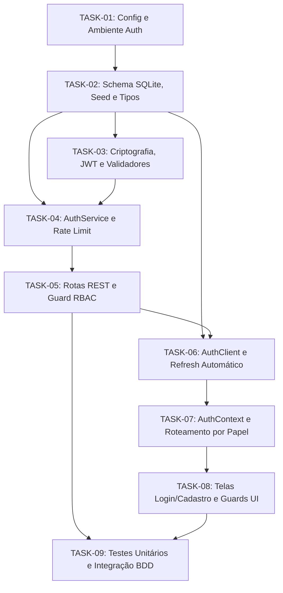

# Autenticação e Controle de Acesso (RBAC) - Plano Técnico de Tarefas

- **Especificação:** `specs/auth-roles.md`
- **Status Geral:** `pending`

## Grafo de Dependências

---

## Contexto Arquitetural do Repositório

- **Backend existente:** Node.js 24 ESM em `server/index.mjs` (sem framework pesado; servidor HTTP nativo em `http://localhost:3001` com testes em `node --test server/*.test.mjs`). A autenticação deve estender esse servidor de forma modular sob `server/auth/`, utilizando banco SQLite persistente (ex.: `node:sqlite` nativo do Node 24) configurável via variável de ambiente (suportando `:memory:` nos testes).
- **Frontend existente:** Expo 54 + Expo Router 6 + React Native Web (`app/(tabs)/index.tsx`), com persistência preventiva já particionada por `ownerId` em `lib/preventive/storage.ts`. O novo módulo cliente deve viver em `lib/auth/` e componentes em `components/auth/`.

---

## Tarefas de Engenharia

### [TASK-01] Configuração de ambiente, variáveis de segurança e dependências
- **Camada:** `config`
- **Status:** `approved`
- **Depende de:** `Nenhuma`
- **Definição de Conclusão (DoD):**
  - Instalar dependências necessárias mantendo compatibilidade com Expo 54 / Node 24: `bcryptjs` (hash com custo ≥ 10 conforme `RN-02`) e `expo-secure-store` (armazenamento seguro de tokens no mobile conforme `RN-02`).
  - Atualizar `.env.example` documentando as novas variáveis sem expor segredos no bundle cliente:
    - `AUTH_JWT_SECRET` (apenas backend, mínimo 32 chars)
    - `AUTH_DB_PATH` (default `./data/torquelab.sqlite`)
    - `AUTH_ACCESS_TTL_SECONDS` (default `900` = 15 min)
    - `AUTH_REFRESH_TTL_SECONDS` (default `604800` = 7 dias)
    - `ADMIN_SEED_EMAIL` e `ADMIN_SEED_PASSWORD` (apenas backend, para criação do administrador inicial)
    - `EXPO_PUBLIC_API_BASE_URL` (ex.: `http://localhost:3001`)
  - Adicionar `data/*.sqlite*` no `.gitignore` para nunca commitar banco local.
  - Criar `server/auth/config.mjs` validando e carregando a configuração com defaults seguros de desenvolvimento e erro explícito em produção se `AUTH_JWT_SECRET` estiver ausente ou fraco (`RN-02`).
- **Notas de Revisão:** Nenhuma

### [TASK-02] Schema de banco SQLite, migração inicial, seed admin e tipagens compartilhadas
- **Camada:** `data_model`
- **Status:** `approved`
- **Depende de:** `TASK-01`
- **Definição de Conclusão (DoD):**
  - Criar `server/auth/db.mjs` inicializando SQLite (`node:sqlite` `DatabaseSync`) com criação idempotente das tabelas:
    - `users`: `id` (UUID/PK), `name` (TEXT NOT NULL), `email` (TEXT NOT NULL UNIQUE COLLATE NOCASE), `password_hash` (TEXT NOT NULL), `role` (`'user' | 'admin'`, CHECK constraint, default `'user'`), `status` (`'active' | 'inactive' | 'blocked'`, default `'active'`), `failed_login_count` (INTEGER default 0), `locked_until` (TEXT nullable), `created_at` (TEXT NOT NULL), `updated_at` (TEXT NOT NULL).
    - `refresh_tokens`: `id` (PK), `user_id` (FK -> `users.id` ON DELETE CASCADE), `token_hash` (TEXT NOT NULL UNIQUE), `expires_at` (TEXT NOT NULL), `revoked_at` (TEXT nullable), `replaced_by_token_id` (TEXT nullable), `created_at` (TEXT NOT NULL).
    - Índices em `users(email)` e `refresh_tokens(user_id, token_hash)`.
  - Implementar rotina idempotente `seedInitialAdmin(db, config)` que cria a conta `admin` ativa com senha hasheada caso `ADMIN_SEED_EMAIL` e `ADMIN_SEED_PASSWORD` estejam configurados e ainda não existam (`RN-02`, base do `Cenário 2`).
  - Criar `lib/auth/types.ts` com tipagens estritas para o frontend: `UserRole` (`"user" | "admin"`), `UserStatus` (`"active" | "inactive" | "blocked"`), `AuthUser`, `AuthTokens`, `AuthSession`, `RegisterPayload`, `LoginPayload`, `AuthApiError`.
- **Notas de Revisão:** Nenhuma

### [TASK-03] Utilitários de criptografia, JWT e validação de payloads
- **Camada:** `service`
- **Status:** `approved`
- **Depende de:** `TASK-02`
- **Definição de Conclusão (DoD):**
  - Criar `server/auth/crypto.mjs` implementando:
    - `hashPassword(plain)` e `verifyPassword(plain, hash)` usando `bcryptjs` com custo ≥ 10 (`RN-02`).
    - `signAccessToken(user)` e `verifyAccessToken(token)` em JWT `HS256` (`node:crypto` HMAC-SHA256) com claims `sub`, `role`, `iat` e `exp` de 15 minutos (`RN-02`).
    - `generateRefreshToken()` (bytes criptograficamente aleatórios com `crypto.randomBytes(48).toString("base64url")`) e `hashToken(rawToken)` (SHA-256) para persistência segura no banco (`RN-02`).
  - Criar `server/auth/validators.mjs` implementando validação estrita de cadastro e login (`RN-01`):
    - `name`: obrigatório, `trim()`, 2 a 80 caracteres.
    - `email`: obrigatório, formato RFC válido, normalizado via `trim().toLowerCase()`.
    - `password`: obrigatória, 8 a 72 caracteres, contendo ao menos 1 letra (`[A-Za-z]`) e 1 dígito (`[0-9]`).
    - Retorno estruturado `{ valid: false, fields: Record<string, string> }` pronto para resposta HTTP `400 Bad Request` sem vazar detalhes internos (`RN-01`).
- **Notas de Revisão:** Nenhuma

### [TASK-04] Serviço de autenticação, rotação de refresh token e proteção contra força bruta
- **Camada:** `service`
- **Status:** `approved`
- **Depende de:** `TASK-02`, `TASK-03`
- **Definição de Conclusão (DoD):**
  - Criar `server/auth/authService.mjs` com injeção de `db` e `clock` (facilitando testes determinísticos) implementando:
    - `register({ name, email, password, ...extra })`: valida via `RN-01`, ignora qualquer `role` vindo no payload forçando `role = "user"` (`RF-01`, `RN-02`), verifica unicidade de e-mail normalizado retornando erro `409 Conflict` (`"Este e-mail já está em uso."`, `Cenário 3`), persiste usuário com `password_hash`, emite `access_token` + `refresh_token` e retorna dados públicos do usuário (`Cenário 1`).
    - `login({ email, password, ip })`: aplica rate limit de 10 tentativas/min por IP (`RN-02`) e verifica bloqueio temporário de 15 minutos após 5 falhas consecutivas na conta retornando erro `429 Too Many Requests` com tempo restante (`RN-02`, `Cenário 5`); rejeita contas `inactive` ou `blocked` com `403 Forbidden` (`RN-02`); em senha inválida ou usuário inexistente, incrementa contador de falhas (quando conta existe) e retorna erro genérico `401 Unauthorized` com `"E-mail ou senha inválidos."` (`RN-02`, `Cenário 5`); em sucesso, zera contador de falhas, gera par de tokens e salva hash do refresh token (`RF-02`, `Cenário 2`).
    - `refresh({ refreshToken })`: valida hash do token no banco, rejeita se inexistente/expirado/revogado (`401`), rejeita se usuário estiver `inactive`/`blocked` (`403`), realiza **rotação** revogando o token antigo (`revoked_at`, `replaced_by_token_id`) e emitindo novo par `access_token` + `refresh_token` (`RN-02`, `Cenário 6`). Se um refresh token já revogado for reutilizado, revoga todas as sessões ativas daquele usuário.
    - `logout({ refreshToken })`: revoga o `refresh_token` correspondente no banco (`RF-02`).
    - `getProfile(userId)`: retorna `{ id, name, email, role, status, createdAt }` sem jamais expor `password_hash` (`RF-04`).
- **Notas de Revisão:** Nenhuma

### [TASK-05] Endpoints REST `/api/auth/*`, middlewares JWT/RBAC e integração no servidor HTTP
- **Camada:** `api_contract`
- **Status:** `approved`
- **Depende de:** `TASK-04`
- **Definição de Conclusão (DoD):**
  - Criar `server/auth/middleware.mjs` com:
    - `requireAuth(request, db)`: extrai `Authorization: Bearer <token>`, valida assinatura/expiração, carrega usuário ativo e anexa `authUser`; retorna `401 Unauthorized` para token ausente/inválido/expirado (`RN-03`) e `403 Forbidden` para conta `inactive`/`blocked` (`RN-02`).
    - `requireRole(role)`: verifica `authUser.role === role` e retorna `403 Forbidden` em caso contrário (`RN-02`, `Cenário 4`).
  - Criar `server/auth/routes.mjs` expondo:
    - `POST /api/auth/register` → `201 Created` (`RF-01`, `Cenário 1`), `400` (`RN-01`), `409` (`Cenário 3`).
    - `POST /api/auth/login` → `200 OK` (`RF-02`, `Cenário 2`), `400`, `401` (`Cenário 5`), `403`, `429` (`Cenário 5`).
    - `POST /api/auth/refresh` → `200 OK` (`RN-02`, `Cenário 6`), `401`, `403`.
    - `POST /api/auth/logout` → `204 No Content` (`RF-02`).
    - `GET /api/auth/me` → `200 OK` (`RF-04`), `401`, `403`.
    - Rota protegida de verificação RBAC `GET /api/admin/health` (ou prefixo guard `/api/admin/*`) aplicando `requireAuth` + `requireRole("admin")` e retornando `403 Forbidden` para `role: "user"` (`RN-02`, `Cenário 4`).
  - Atualizar `server/index.mjs` preservando integralmente `/api/vehicles/:plate` (sem quebrar `npm run test:api`):
    - Habilitar CORS para métodos `GET, POST, PUT, PATCH, DELETE, OPTIONS` e headers `Content-Type, Authorization`, além de `Access-Control-Allow-Credentials: true` quando aplicável.
    - Parser seguro de JSON com limite de tamanho (ex.: 16 KB) retornando `400 Bad Request` para JSON inválido.
    - Tratamento global de exceções retornando `503 Service Unavailable` (erro de DB) ou `500 Internal Server Error` com mensagem amigável e sem stack trace (`RN-03`).
- **Notas de Revisão:** Nenhuma

### [TASK-06] Cliente HTTP de autenticação, armazenamento seguro de tokens e renovação automática
- **Camada:** `service`
- **Status:** `approved`
- **Depende de:** `TASK-02`, `TASK-05`
- **Definição de Conclusão (DoD):**
  - Criar `lib/auth/tokenStorage.ts` abstraindo armazenamento de `access_token` e `refresh_token`:
    - Mobile (`ios`/`android`): utiliza `expo-secure-store`.
    - Web: suporta persistência segura compatível (cookie `HttpOnly` quando mesma origem/backend configurado ou fallback isolado em `sessionStorage`/storage dedicado sem vazar em logs), com interface injetável para testes.
  - Criar `lib/auth/authClient.ts` implementando:
    - Chamadas `register`, `login`, `logout`, `refresh`, `getMe` contra `EXPO_PUBLIC_API_BASE_URL` com **timeout de 10 segundos** via `AbortController` e erro amigável para retry (`RN-03`).
    - Wrapper `authenticatedFetch(path, init)` que injeta `Authorization: Bearer <access_token>` e, ao receber HTTP `401 Unauthorized`, executa **uma única renovação automática** via `POST /api/auth/refresh` (com deduplicação de concorrência via promise compartilhada para evitar múltiplos refreshes simultâneos) e repete a requisição original (`RN-03`, `Cenário 6`).
    - Se a renovação falhar, limpa tokens locais e dispara callback de sessão expirada (`onSessionExpired`) para redirecionar ao login (`RN-03`).
- **Notas de Revisão:** Nenhuma

### [TASK-07] Contexto global de sessão, restauração no boot e integração com `ownerId`
- **Camada:** `service`
- **Status:** `approved`
- **Depende de:** `TASK-06`
- **Definição de Conclusão (DoD):**
  - Criar `lib/auth/AuthContext.tsx` provendo `AuthProvider` e hook `useAuth()` com estados: `status` (`"loading" | "authenticated" | "unauthenticated" | "guest"`), `user`, `activePortal` (`"user" | "admin"`), `authError`, além das ações `signIn`, `signUp`, `signOut`, `enterGuestMode`, `switchAdminPortal(portal)`.
  - Na inicialização do app, restaurar sessão chamando `getMe()` (com refresh automático se necessário):
    - Se `role === "admin"`, definir `activePortal = "admin"` permitindo alternar para `"user"` (`RF-03`, `Cenário 2`).
    - Se `role === "user"`, fixar `activePortal = "user"` e bloquear troca para `"admin"` (`RF-03`, `Cenário 4`).
    - Em caso de falha de rede/timeout no boot, manter feedback de erro com botão "Tentar novamente" (`RN-03`).
  - Integrar `user.id` como `ownerId` ao carregar/salvar dados em `lib/preventive/storage.ts`, mantendo `DEFAULT_LOCAL_OWNER_ID` apenas no modo visitante demonstração (`RN-04`).
- **Notas de Revisão:** Nenhuma

### [TASK-08] Telas de Login/Cadastro, modo visitante, menu de conta e guarda RBAC na UI
- **Camada:** `ui`
- **Status:** `in_progress`
- **Depende de:** `TASK-07`
- **Definição de Conclusão (DoD):**
  - Criar `components/auth/AuthScreen.tsx` seguindo a identidade visual dark + crimson do TorqueLab (mobile-first e responsivo):
    - Alternância entre abas **Entrar (Login)** e **Criar conta (Cadastro)** (`RF-01`, `RF-02`).
    - Validação inline antes do envio (nome, e-mail, força mínima da senha de 8+ chars com letra e dígito) e exibição clara dos erros vindos da API (`400`, `401`, `403`, `409`, `429` com aviso de tempo de espera, timeout com botão **"Tentar novamente"**) (`RN-01`, `RN-02`, `RN-03`, `Cenários 3 e 5`).
    - Opção secundária **"Continuar como visitante (modo demonstração)"** que libera o simulador sem persistência em nuvem e informa claramente que o Dashboard completo requer conta (`RN-04`).
  - Criar `components/auth/RoleGuard.tsx` impedindo que usuário `user` renderize o portal `admin`, redirecionando automaticamente para o Dashboard do Usuário com banner `"Permissão insuficiente para acessar o painel administrativo."` (`RF-03`, `Cenário 4`).
  - Criar `components/auth/AccountMenu.tsx` na barra superior exibindo nome, papel (`Usuário` ou `Admin`), botão **"Sair" (logout)** (`RF-02`) e, somente para `admin`, alternador **"Painel Admin / Minha Garagem"** (`RF-03`).
  - Envolver o app em `AuthProvider` (`app/(tabs)/_layout.tsx` ou `app/(tabs)/index.tsx`) e renderizar:
    - Visitante não autenticado → `AuthScreen` (ou modo demonstração do simulador quando escolhido).
    - `user` autenticado → Dashboard do Usuário (`PreventiveDashboard` + abas existentes).
    - `admin` autenticado → Container inicial do Dashboard Admin (placeholder estruturado pronto para receber `specs/admin-dashboard.md`) com acesso ao modo garagem (`Cenário 2`).
- **Notas de Revisão:** Nenhuma

### [TASK-09] Testes automatizados cobrindo todos os cenários BDD e verificação de build
- **Camada:** `test`
- **Status:** `pending`
- **Depende de:** `TASK-05`, `TASK-08`
- **Definição de Conclusão (DoD):**
  - Criar `server/auth/auth.test.mjs` usando `node --test` com SQLite em memória (`:memory:`) cobrindo obrigatoriamente:
    - **Cenário 1:** Cadastro válido via `POST /api/auth/register` retorna `201`, força `role: "user"` mesmo se `role: "admin"` for enviado no body, armazena senha hasheada (nunca em texto puro) e emite tokens válidos (`RF-01`, `RN-01`, `RN-02`).
    - **Cenário 2:** Login de administrador seedado via `POST /api/auth/login` retorna `200` com `role: "admin"` e acesso liberado em `/api/auth/me` e `/api/admin/health` (`RF-02`, `RF-04`).
    - **Cenário 3:** Cadastro com e-mail duplicado em caixa diferente (`"BRUNO@exemplo.com"`) retorna `409 Conflict` com `"Este e-mail já está em uso."` (`RN-01`).
    - **Cenário 4:** Usuário `user` acessando `/api/admin/health` recebe `403 Forbidden` (`RN-02`).
    - **Cenário 5:** 5 senhas erradas retornam `401` com `"E-mail ou senha inválidos."` e a 6ª tentativa na janela de 15 min retorna `429 Too Many Requests` com tempo estimado; conta `inactive`/`blocked` retorna `403` (`RN-02`).
    - **Logout e Rotação:** `POST /api/auth/refresh` rotaciona o refresh token e invalida o anterior; `POST /api/auth/logout` impede novo refresh com o token revogado (`RF-02`, `RN-02`).
  - Criar `lib/auth/authClient.test.ts` validando o **Cenário 6**: requisição com `access_token` expirado recebe `401`, dispara exatamente 1 chamada a `POST /api/auth/refresh`, salva os novos tokens e repete a requisição original com sucesso (`RN-03`), além do timeout de 10s.
  - Adicionar script `"test:auth"` no `package.json` e garantir passagem integral de `npm run test:auth`, `npm run test:api`, `npm run test:preventive`, `npx tsc --noEmit`, `npm run lint` e `npm run build`.
- **Notas de Revisão:** Nenhuma
