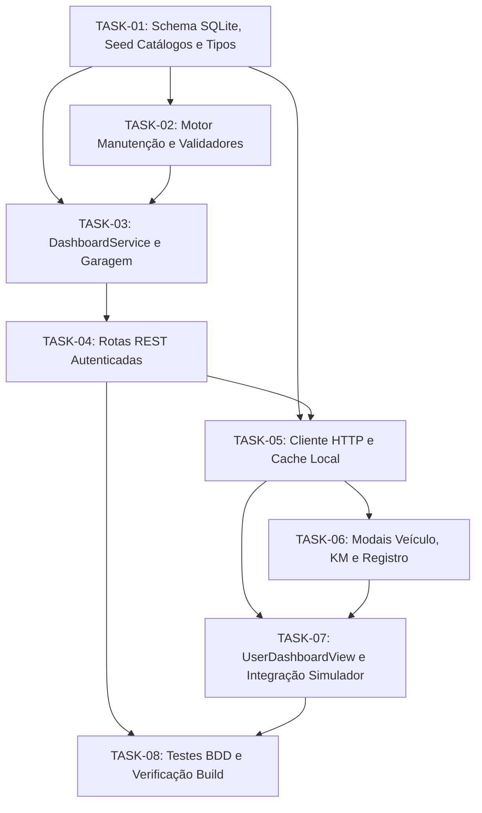

# Dashboard do Usuário (Veículos e Manutenções) - Plano Técnico de Tarefas

- **Especificação:** `specs/user-dashboard.md`
- **Status Geral:** `pending`

## Grafo de Dependências

---

## Contexto Arquitetural do Repositório

- **Backend existente:** Node.js 24 ESM em `server/index.mjs` com autenticação JWT/RBAC e SQLite (`node:sqlite` `DatabaseSync`) já ativos em `server/auth/`. O domínio do Dashboard do Usuário deve compartilhar a mesma instância SQLite (via `ensureDashboardSchema(db)` em `server/dashboard/db.mjs`) para manter chaves estrangeiras (`owner_id -> users.id`) e preparar os catálogos (`catalog_vehicles` e `catalog_services`) para consumo posterior por `specs/admin-dashboard.md`.
- **Frontend existente:** Expo 54 + React Native Web (`app/(tabs)/index.tsx`), `AuthContext` (`lib/auth/AuthContext.tsx`), `defaultAuthClient.authenticatedFetch` (`lib/auth/defaultAuthClient.ts`), API FIPE (`app/(tabs)/services/fipeApi.ts`), analisador (`app/(tabs)/utils/analyzer.ts`) e simulador completo. Para usuários autenticados (`role: "user"` ou `admin` em "Minha Garagem"), o Dashboard do Usuário integrado ao backend vira a experiência principal mantendo o simulador completo e o modo visitante 100% operacionais.

---

## Tarefas de Engenharia

### [TASK-01] Schema SQLite de veículos/catálogos/logs, seed inicial e tipagens compartilhadas
- **Camada:** `data_model`
- **Status:** `approved`
- **Depende de:** `Nenhuma`
- **Definição de Conclusão (DoD):**
  - Criar `server/dashboard/db.mjs` exportando `ensureDashboardSchema(db)` e `seedDefaultCatalogs(db)` (idempotentes):
    - `catalog_vehicles`: `id`, `brand`, `model`, `year`, `fuel`, `category` (`'compact' | 'medium_suv' | 'diesel_pickup' | 'premium' | 'electric'`), `cost_factor` (REAL), `reference_consumption` (REAL), `fipe_price` (TEXT), `active` (INTEGER DEFAULT 1), `created_at`, `updated_at`.
    - `catalog_services`: `id`, `name` (UNIQUE COLLATE NOCASE), `category`, `interval_km` (INTEGER NOT NULL), `interval_months` (INTEGER nullable), `base_cost` (REAL NOT NULL), `combustion_only` (INTEGER NOT NULL DEFAULT 0), `notes` (TEXT), `active` (INTEGER NOT NULL DEFAULT 1), `created_at`, `updated_at`.
    - `user_vehicles`: `id`, `owner_id` (FK -> `users.id` ON DELETE CASCADE), `catalog_vehicle_id` (nullable FK -> `catalog_vehicles.id`), `nickname` (TEXT), `brand`, `model`, `year`, `version`, `fuel`, `category`, `cost_factor`, `plate`, `fipe_price`, `fipe_code`, `fipe_cached` (INTEGER DEFAULT 0), `current_km` (INTEGER NOT NULL), `last_revision_months` (INTEGER NOT NULL DEFAULT 0), `health_score` (INTEGER NOT NULL DEFAULT 85), `estimated_consumption` (REAL NOT NULL DEFAULT 11.5), `is_active` (INTEGER NOT NULL DEFAULT 0), `is_demo` (INTEGER NOT NULL DEFAULT 0), `deleted_at` (TEXT nullable), `created_at`, `updated_at`.
    - `maintenance_logs`: `id`, `vehicle_id` (FK -> `user_vehicles.id` ON DELETE CASCADE), `owner_id` (FK -> `users.id` ON DELETE CASCADE), `service_id` (nullable FK -> `catalog_services.id`), `service_name` (TEXT NOT NULL), `performed_at` (TEXT NOT NULL), `performed_km` (INTEGER NOT NULL), `paid_cost` (REAL nullable), `estimated_cost` (REAL NOT NULL), `notes` (TEXT), `created_at`.
    - Índices em `user_vehicles(owner_id, deleted_at)`, `maintenance_logs(vehicle_id, service_id)` e `catalog_services(active)`.
  - Seed idempotente de catálogo inicial com veículos representativos (incluindo `Toyota Corolla 2022`, `BYD Dolphin 2024` elétrico, `Jeep Compass 2021`, `Chevrolet Onix 2022`, `Hyundai HB20 2023`, `Volkswagen Polo 2023`, `Fiat Strada 2023`, `Honda HR-V 2022`, `BMW 320i 2022`) e serviços de manutenção padrão (`Óleo do motor + filtro de óleo` 10.000 km / 12 meses `combustionOnly`, `Alinhamento e balanceamento` 10.000 km, `Filtro de cabine` 15.000 km / 12 meses, `Filtros de ar do motor e combustível` 15.000 km `combustionOnly`, `Pastilhas de freio (revisão)` 20.000 km, `Fluido de freio` 30.000 km / 24 meses, `Velas de ignição` 40.000 km `combustionOnly`, `Correia dentada / acessórios` 60.000 km `combustionOnly`).
  - Integrar `ensureDashboardSchema(db)` + `seedDefaultCatalogs(db)` na inicialização de `openAuthDatabase` em `server/auth/db.mjs` para que todo banco aberto já possua as tabelas prontas.
  - Criar `lib/dashboard/types.ts` com tipagens estritas para `VehicleCategory`, `CatalogVehicle`, `CatalogService`, `UserVehicle`, `MaintenanceUrgency` (`"urgent" | "recommended" | "upcoming"`), `DashboardMaintenanceItem`, `MaintenanceLogItem`, `DashboardSummary`, `DashboardResponse`, `CreateVehiclePayload`, `UpdateVehiclePayload`, `CreateMaintenanceLogPayload`.
- **Notas de Revisão:** Nenhuma

### [TASK-02] Motor de cálculo de manutenções aplicáveis, custos e validadores
- **Camada:** `service`
- **Status:** `in_progress`
- **Depende de:** `TASK-01`
- **Definição de Conclusão (DoD):**
  - Criar `server/dashboard/validators.mjs` cobrindo `RN-01`:
    - `validateCreateVehiclePayload(body)`: valida `brand` (2–80), `model` (2–80), `year` (1950..anoAtual+2), `currentKm` (inteiro `0..2000000`), `nickname` (opcional, ≤ 40 chars), `lastRevisionMonths` (inteiro `0..120`, default 0), `fuel`, `category` (com inferência automática se omitido), `plate` (opcional ≤ 10 chars), `fipePrice`, `fipeCode`, `healthScore` (0..100), `estimatedConsumption` (> 0).
    - `validateUpdateVehiclePayload(body)`: valida atualização parcial (`nickname`, `currentKm`, `lastRevisionMonths`, `fipePrice`, `fipeCached`, `plate`, `version`, `healthScore`, `estimatedConsumption`, `confirmKmRegression` booleano). Rejeita `currentKm < 0` ou `> 2000000` com `400 Bad Request` e mapa `fields` (`Cenário 6`).
    - `validateCreateMaintenanceLogPayload(body)`: valida `vehicleId`, `serviceId`, `performedAt` (YYYY-MM-DD válida), `performedKm` (`0..2000000`), `paidCost` (opcional ≥ 0 e ≤ 100000), `notes` (opcional ≤ 200).
  - Criar `server/dashboard/maintenanceEngine.mjs` cobrindo `RN-02`:
    - `roundToNearest5(value)`: arredonda para múltiplo de 5 (`Math.round(value / 5) * 5`).
    - `isElectricVehicle(vehicle)`: detecta categoria `"electric"` ou combustível/nome elétrico.
    - `inferVehicleCategory(vehicle)`: classifica em `electric`, `premium`, `diesel_pickup`, `medium_suv` ou `compact` com respectivo `costFactor` (`0.95`, `1.85`, `1.45`, `1.22`, `1.0`).
    - `evaluateVehicleMaintenances(vehicle, activeServices, logs, referenceDate)`:
      - Filtra serviços `active = true` e omite `combustionOnly = true` para veículos elétricos (`RN-02`, `Cenário 2`).
      - Calcula `estimatedCost = roundToNearest5(service.baseCost * costFactor)`.
      - Aplica exatamente as 3 regras de **Necessário agora** (`RN-02`): (1) sem log e `currentKm >= intervalKm`; (2) com último log e `(currentKm - lastDoneKm) >= intervalKm`; (3) com `intervalMonths` e meses decorridos desde `lastDoneAt` (ou `lastRevisionMonths`) ≥ `intervalMonths`.
      - Classifica como **Urgente** (`"urgent"`) se vencido há > 20% do intervalo ou > 2.000 km acima do marco (ou > 20% dos meses), **Recomendada agora** (`"recommended"`) se necessário agora, e **Próxima revisão** (`"upcoming"`) caso ainda dentro do prazo.
      - Calcula `nextDueKm`, `nextDueDate`, `overdueKm`, `overdueMonths`, resumo de contadores (`urgentCount`, `recommendedCount`, `upcomingCount`, `nextMilestoneKm`, `totalDueCost`) e `healthScore` coerente.
- **Notas de Revisão:** Nenhuma

### [TASK-03] Serviço de garagem multi-veículo, registros de manutenção e agregação do Dashboard
- **Camada:** `service`
- **Status:** `pending`
- **Depende de:** `TASK-01`, `TASK-02`
- **Definição de Conclusão (DoD):**
  - Criar `server/dashboard/dashboardService.mjs` com `DashboardError(status, message, options)` e `createDashboardService({ db, now = () => Date.now() })`:
    - `listCatalogVehicles({ search, category })`: retorna veículos ativos do catálogo interno para fallback/cadastro rápido (`RN-04`).
    - `getDashboard(ownerId, { vehicleId } = {})`: busca veículos ativos (`deleted_at IS NULL`) do proprietário (`RN-03`); se vazio retorna `{ empty: true, vehicles: [], activeVehicle: null, summary: null, maintenances: [], history: [] }` (`RF-05`, `Cenário 5`); caso contrário seleciona o veículo solicitado (validando pertencimento ao `ownerId` -> `404` se de terceiro), ou o marcado com `is_active = 1`, ou o mais recente; calcula manutenções via `evaluateVehicleMaintenances` usando apenas `catalog_services` ativos, e retorna histórico completo (preservando registros mesmo de serviços posteriormente desativados pelo Admin — `RN-02`).
    - `createVehicle(ownerId, payload)`: impõe limite de **20 veículos ativos** por conta retornando `DashboardError(422, ...)` acima do limite (`RN-01`); define o novo carro como `is_active = 1` desmarcando os anteriores em transação; retorna veículo criado.
    - `updateVehicle(ownerId, vehicleId, payload)`: verifica propriedade estrita (`owner_id === ownerId`, retornando `404` se não pertencer ao usuário — `RN-03`, `Cenário 6`); se `currentKm < vehicle.current_km` e `!payload.confirmKmRegression`, retorna `DashboardError(409, "A nova quilometragem é menor que a atual. Confirme para corrigir.", { requiresKmRegressionConfirmation: true })` (`RN-01`); atualiza e retorna o veículo.
    - `selectActiveVehicle(ownerId, vehicleId)`: marca o veículo do proprietário como ativo (`is_active = 1`) e desmarca os demais (`RF-01`, `Cenário 2`), retornando `404` se pertencer a outro usuário.
    - `deleteVehicle(ownerId, vehicleId)`: aplica **soft delete** (`deleted_at = nowIso`, `is_active = 0`) apenas se pertencer ao proprietário (`RN-03`, `RN-04`); se era o ativo, promove automaticamente o próximo veículo ativo mais recente da garagem (`RN-04`).
    - `createMaintenanceLog(ownerId, payload)`: verifica propriedade do veículo (`RN-03`), resolve serviço ativo do catálogo (ou rejeita `400`/`404`), calcula `estimatedCost`, salva `paidCost` se informado sem alterar `catalog_services` (`RN-02`), atualiza `current_km` do veículo caso `performedKm > current_km`, e retorna `{ log, dashboard }` já recalculado (`RF-03`, `Cenário 3`).
    - `listMaintenanceLogs(ownerId, vehicleId)`: lista histórico do veículo pertencente ao `ownerId` ordenado por data mais recente (`RN-02`, `RN-03`).
- **Notas de Revisão:** Nenhuma

### [TASK-04] Endpoints REST do Dashboard e integração em `server/index.mjs`
- **Camada:** `api_contract`
- **Status:** `pending`
- **Depende de:** `TASK-03`
- **Definição de Conclusão (DoD):**
  - Criar `server/dashboard/routes.mjs` exportando `createDashboardRouter({ db, getDb, config, now })` protegendo **todas** as rotas com `authenticateRequest` (HTTP `401` se não autenticado — `RN-03`):
    - `GET /api/dashboard` (aceita `?vehicleId=...`) → `200 OK` (`RF-01`, `RF-02`, `RF-03`, `RF-05`, `Cenários 1, 2, 5`).
    - `GET /api/catalog/vehicles` → `200 OK` com veículos ativos do catálogo interno (`RN-04`).
    - `GET /api/user/vehicles` → `200 OK` com lista de veículos do usuário.
    - `POST /api/user/vehicles` → `201 Created` (ou `400` validação / `422` limite 20 carros — `RN-01`).
    - `PATCH /api/user/vehicles/:id` → `200 OK` (ou `400` km negativo / `404` veículo de terceiro / `409` confirmação de regressão — `RN-01`, `RN-03`, `Cenário 6`).
    - `POST /api/user/vehicles/:id/select` → `200 OK` com dashboard atualizado (`Cenário 2`).
    - `DELETE /api/user/vehicles/:id` → `200 OK` com `{ deletedId, nextActiveVehicleId }` (`RN-04`).
    - `GET /api/user/maintenance-logs` (aceita `?vehicleId=...`) → `200 OK`.
    - `POST /api/user/maintenance-logs` → `201 Created` com `{ log, dashboard }` (`Cenário 3`).
  - Integrar `handleDashboardRoute` no `server/index.mjs` preservando integralmente `/api/health`, `/api/auth/*`, `/api/admin/*`, `/api/vehicles/:plate` e o servidor estático.
  - Garantir `npm run test:api` e `npm run test:auth` continuam 100% verdes.
- **Notas de Revisão:** Nenhuma

### [TASK-05] Cliente HTTP do Dashboard e camada de cache local resiliente
- **Camada:** `service`
- **Status:** `pending`
- **Depende de:** `TASK-01`, `TASK-04`
- **Definição de Conclusão (DoD):**
  - Criar `lib/dashboard/dashboardClient.ts` (puro TypeScript sem imports de React Native, recebendo `authClient` injetável para testes):
    - Métodos: `getDashboard(vehicleId?)`, `listCatalogVehicles(search?)`, `createVehicle(payload)`, `updateVehicle(id, payload)`, `selectVehicle(id)`, `deleteVehicle(id)`, `createMaintenanceLog(payload)`, `listMaintenanceLogs(vehicleId?)`.
    - Utiliza `authClient.authenticatedFetch` (herdando timeout de 10s e refresh automático em `401`).
    - Lança `DashboardClientError(status, message, { fields?, requiresKmRegressionConfirmation?, isTimeout?, isNetworkError? })`.
  - Criar `lib/dashboard/defaultDashboardClient.ts` conectando `createDashboardClient(defaultAuthClient)`.
  - Criar `lib/dashboard/dashboardCache.ts` persistindo o último `DashboardResponse` por `ownerId` em `AsyncStorage` (`torquelab-dashboard-cache-v1:${ownerId}`), permitindo degradação graciosa caso `/api/dashboard` falhe ou fique offline (`RN-04`).
- **Notas de Revisão:** Nenhuma

### [TASK-06] Modais de cadastro/edição de veículo, hodômetro com confirmação e registro de manutenção
- **Camada:** `ui`
- **Status:** `pending`
- **Depende de:** `TASK-05`
- **Definição de Conclusão (DoD):**
  - Criar `components/dashboard/UserVehicleModal.tsx`:
    - Permite cadastrar novo veículo ou editar veículo existente com: Marca, Modelo, Ano, Apelido (`≤ 40` chars), Versão, Combustível, Categoria, Quilometragem atual (`0..2.000.000`), Meses desde última revisão (`0..120`), Placa opcional e Valor FIPE.
    - Suporta preenchimento via **Tabela FIPE** (reaproveitando `buscarMarcas`/`buscarModelos`/`buscarAnos`/`buscarDadosFipe` + `SeletorModal`) E via **Catálogo interno do TorqueLab** (`GET /api/catalog/vehicles` — funcionando mesmo se a FIPE estiver indisponível, `RN-04`).
    - Exibe erros inline por campo e alerta claro para `422` (limite de 20 veículos).
  - Criar `components/dashboard/QuickKmModal.tsx`:
    - Atualização rápida do hodômetro do veículo ativo com atalhos (+100, +500, +1.000 km).
    - Valida `0..2.000.000` inline; se o novo KM for menor que o atual, exibe **caixa de confirmação explícita de correção de digitação** antes de enviar `confirmKmRegression: true` (`RN-01`).
  - Criar `components/dashboard/LogMaintenanceModal.tsx`:
    - Modal **"Marcar como realizada"** pré-preenchido com data de hoje, `currentKm` do veículo e valor estimado sugerido (editável para registrar valor real pago sem alterar o catálogo global — `RF-03`, `RN-02`, `Cenário 3`), além de observação opcional.
- **Notas de Revisão:** Nenhuma

### [TASK-07] Dashboard Principal do Usuário e integração com o Simulador Completo
- **Camada:** `ui`
- **Status:** `pending`
- **Depende de:** `TASK-05`, `TASK-06`
- **Definição de Conclusão (DoD):**
  - Criar `components/dashboard/UserDashboardView.tsx` no tema visual TorqueLab (dark + crimson, mobile-first e responsivo) implementando integralmente:
    - **Seletor multi-carro no topo (`RF-01`, `Cenário 2`):** pills de todos os veículos cadastrados (apelido/marca/modelo/ano/km), botão `+ Adicionar carro`, ação editar e ação excluir com **confirmação explícita** (`RN-04`).
    - **Estado vazio (`RF-05`, `Cenário 5`):** quando o usuário não tem veículos, exibe tela orientada com CTA principal **"Cadastrar meu primeiro carro"** e botão secundário **"Testar carro de demonstração"** (cria um carro demo ilustrativo na conta para testar imediatamente).
    - **Hero / KPIs do veículo ativo (`RF-02`, `Cenário 1`):** marca, modelo, ano, combustível, placa (se informada), valor FIPE (com selo `"FIPE em cache"` quando `fipeCached` for verdadeiro — `RN-04`), quilometragem atual com botão rápido **"Atualizar KM"**, nota geral de saúde (0–100), consumo estimado (km/L ou km/kWh), contadores de manutenções (Urgentes, Recomendadas, Próximas), próximo marco de KM e **custo total dinâmico**.
    - **Painel de Manutenções Necessárias (`RF-03`, `RN-02`, `Cenários 1, 2, 3`):** lista serviços aplicáveis (omitindo automaticamente itens de combustão para elétricos) com badges **Atrasada / Urgente** (vermelho), **Recomendada agora** (amarelo) e **Próxima revisão** (verde), checkbox individual para incluir/remover do **valor total somado**, preço unitário estimado e botão **"Marcar como realizada"**.
    - **Botão "Abrir simulador completo" (`RF-04`, `Cenário 4`):** abre o simulador detalhado pré-preenchido com marca, modelo, ano, combustível, FIPE e KM do veículo ativo; ao concluir a análise no simulador, permite salvar/atualizar a nota de saúde e consumo estimado de volta no veículo do Dashboard via `PATCH /api/user/vehicles/:id`.
    - **Banner de erro não destrutivo (`RN-04`):** se `/api/dashboard` falhar, preserva o último snapshot em cache local e exibe botão **"Recarregar painel"**.
    - **Histórico de serviços realizados** exibido em aba/seção dedicada mostrando serviço, data, KM e valor pago/estimado (inclusive de serviços desativados no catálogo).
  - Integrar `UserDashboardView` em `app/(tabs)/index.tsx` como tela principal dos usuários autenticados (mantendo o modo Visitante com a demonstração local existente e o portal Admin intactos).
- **Notas de Revisão:** Nenhuma

### [TASK-08] Testes de aceitação BDD (`spec-verifier`) e validação de build
- **Camada:** `test`
- **Status:** `pending`
- **Depende de:** `TASK-04`, `TASK-07`
- **Definição de Conclusão (DoD):**
  - Criar `server/dashboard/dashboard.test.mjs` usando `node --test` + SQLite `:memory:` cobrindo todos os cenários BDD e regras:
    - **Cenário 1:** Carregamento do Dashboard (`GET /api/dashboard`) para `"Toyota Corolla 2022"` com `60.000 km` retorna KPIs, serviços devidos com valores individuais arredondados para múltiplo de 5 e custo total somado.
    - **Cenário 2:** Alternância para `"BYD Dolphin 2024"` elétrico a `20.000 km` (`POST /api/user/vehicles/:id/select`) omite serviços `combustionOnly` (ex.: óleo e velas) e recalcula custos para 20.000 km.
    - **Cenário 3:** `POST /api/user/maintenance-logs` para `"Óleo do motor + filtro de óleo"` a `60.000 km` por `R$ 420,00` retorna `201 Created`, remove das pendências atuais, recalcula próximo vencimento para `70.000 km`, atualiza total pendente e preserva catálogo global inalterado.
    - **Cenário 5:** Novo usuário sem veículos recebe `empty: true` em `GET /api/dashboard`.
    - **Cenário 6:** `PATCH /api/user/vehicles/:id` com `currentKm: -500` retorna `400 Bad Request`; acesso/edição/exclusão/log em veículo de outro usuário retorna `404`/`403` sem alterar dados; `GET /api/dashboard` sem token retorna `401`.
    - **Regras extras (`RN-01`, `RN-02`, `RN-04`):** limite de 20 veículos ativos (`422`), confirmação de regressão de KM (`409` sem `confirmKmRegression`, `200` com `confirmKmRegression: true`), serviço vencido por meses (`intervalMonths`), desativação de serviço mantendo histórico, e soft delete promovendo próximo veículo ativo.
  - Criar `lib/dashboard/dashboardClient.test.ts` validando o cliente HTTP (chamadas autenticadas, erro `400`/`409`/`422`, e propagação de refresh em `401`).
  - Adicionar script `"test:dashboard"` no `package.json` e executar `npm run test:dashboard`, `npm run test:auth`, `npm run test:api`, `npm run test:preventive`, `npx tsc --noEmit`, `npm run lint` e `npm run build` com 0 erros.
- **Notas de Revisão:** Nenhuma
