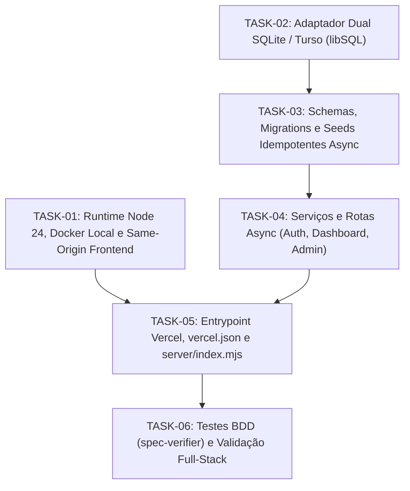

# Deploy Full-Stack na Vercel (API Serverless + Turso/libSQL + Same-Origin & Docker Local) - Plano Técnico de Tarefas

- **Especificação:** `specs/vercel-fullstack-deploy.md`
- **Status Geral:** `approved`

## Grafo de Dependências

---

## Contexto Arquitetural do Repositório

- **Frontend Web:** Expo 54 + Expo Router 6 exportando bundle estático em `dist/` via `npx expo export --platform web`. `lib/auth/authClient.ts` já suporta `same-origin`, mas `app/(tabs)/services/plateApi.ts` ainda usa `EXPO_PUBLIC_PLATE_API_URL` sem fallback `same-origin` e `Dockerfile` / `docker-compose.yml` ainda apontam para `http://localhost:3001/api/vehicles` e `WEB_BASE_PATH=/SimuladorMotor1`.
- **Backend atual:** Node.js 24 ESM em `server/index.mjs` com `node:sqlite` (`DatabaseSync`) síncrono. Na Vercel, funções *serverless* não executam `Dockerfile` nem mantêm disco local persistente, exigindo adaptador assíncrono compatível com `@libsql/client` (Turso) em produção e `node:sqlite` (`./data/torquelab.sqlite` / `:memory:`) localmente.

---

## Tarefas de Engenharia

### [TASK-01] Configuração de Runtime Node 24, Docker local e resolução Same-Origin no Frontend
- **Camada:** `config`
- **Status:** `approved`
- **Depende de:** `Nenhuma`
- **Definição de Conclusão (DoD):**
  - Atualizar `package.json` adicionando `"engines": { "node": "24.x" }` para garantir suporte nativo a `argon2Sync` na Vercel (`RN-03`).
  - Atualizar `app/(tabs)/services/plateApi.ts` (`RF-04`, `Cenário 4`) para aceitar `EXPO_PUBLIC_PLATE_API_URL=same-origin` ou caminho relativo `/api/vehicles` (resolvendo no navegador para `${window.location.origin}/api/vehicles` ou `/api/vehicles`, mantendo fallback funcional quando variável não estiver definida em ambiente web fora das portas de dev).
  - Revisar `lib/auth/authClient.ts` (`RF-04`, `Cenário 1`) garantindo que `EXPO_PUBLIC_API_BASE_URL` vazio ou `same-origin` no navegador fora das portas de dev (`8081`, `8082`, `19006`) resolva sempre para `window.location.origin` sem trailing slash.
  - Atualizar `Dockerfile` e `docker-compose.yml` (`RF-05`, `Cenário 6`) alinhando `WEB_BASE_PATH=/`, `EXPO_PUBLIC_API_BASE_URL=same-origin` e `EXPO_PUBLIC_PLATE_API_URL=/api/vehicles` para execução local em container.
  - Atualizar `.env.example` documentando `TURSO_DATABASE_URL` e `TURSO_AUTH_TOKEN` (sem prefixo `EXPO_PUBLIC_`, `RN-04`) além de `EXPO_PUBLIC_API_BASE_URL=same-origin` e `EXPO_PUBLIC_PLATE_API_URL=/api/vehicles` para produção Vercel.
- **Notas de Revisão:** Nenhuma

### [TASK-02] Adaptador assíncrono dual de banco de dados (`node:sqlite` local + `@libsql/client` Turso)
- **Camada:** `data_model`
- **Status:** `approved`
- **Depende de:** `Nenhuma`
- **Definição de Conclusão (DoD):**
  - Criar `server/db/adapter.mjs` expondo interface assíncrona unificada (`exec`, `get`, `all`, `run`, `transaction`, `close`) para ambos os drivers (`RF-02`).
  - Selecionar `@libsql/client` automaticamente quando `TURSO_DATABASE_URL` estiver definida (validando presença de `TURSO_AUTH_TOKEN` para URLs `libsql://` ou `https://`, `RN-02`).
  - Bloquear explicitamente inicialização em `VERCEL=1` + `NODE_ENV=production` sem `TURSO_DATABASE_URL` lançando erro identificável para retorno `503` (`RN-02`, `Cenário 3`).
  - Manter `node:sqlite` (`DatabaseSync`) para `AUTH_DB_PATH` local/Docker e `:memory:` em `NODE_ENV=test`.
- **Notas de Revisão:** Nenhuma

### [TASK-03] Inicialização idempotente de schemas, migrations e seeds para Cold Start Serverless
- **Camada:** `service`
- **Status:** `approved`
- **Depende de:** `TASK-02`
- **Definição de Conclusão (DoD):**
  - Adaptar `server/auth/db.mjs` e `server/dashboard/db.mjs` para operar sobre o adaptador assíncrono de `server/db/adapter.mjs`.
  - Garantir execução idempotente de criação de tabelas/índices, verificação de colunas via `PRAGMA table_info(...)` (`updated_by`, `last_revision_km`), `seedDefaultCatalogs` e `seedInitialAdmin` sob singleton `initPromise` por instância (`RF-03`, `Cenário 2`).
- **Notas de Revisão:** Nenhuma

### [TASK-04] Adaptação assíncrona dos serviços e rotas (`auth`, `dashboard`, `admin`)
- **Camada:** `service`
- **Status:** `approved`
- **Depende de:** `TASK-03`
- **Definição de Conclusão (DoD):**
  - Atualizar `server/auth/` (`authService.mjs`, `middleware.mjs`, `routes.mjs`), `server/dashboard/` (`dashboardService.mjs`, `routes.mjs`) e `server/admin/` (`adminService.mjs`, `routes.mjs`) para `async/await` sobre o adaptador dual (`RN-03`), preservando bloqueio persistente de tentativas falhas de login na tabela `users` (`RN-05`) e mapeamento de erros de conexão para `503` (`RN-04`).
- **Notas de Revisão:** Nenhuma

### [TASK-05] Entrypoint Serverless da Vercel (`api/[...route].mjs`), `vercel.json` e CORS unificado
- **Camada:** `api_contract`
- **Status:** `approved`
- **Depende de:** `TASK-01`, `TASK-04`
- **Definição de Conclusão (DoD):**
  - Criar `api/[...route].mjs` reutilizando o roteamento HTTP de `server/index.mjs` com inicialização `initPromise` em *cold start* (`RF-01`, `RF-03`).
  - Criar `vercel.json` configurando build Expo Web (`dist/`), roteamento `/api/(.*)` para a função *serverless* e SPA fallback para `index.html`.
  - Garantir em `server/index.mjs` política CORS estrita (`RN-01`, `Cenário 5`) sem `Access-Control-Allow-Origin: *` em rotas autenticadas e retorno `503` em falhas de configuração/conexão Turso (`RN-04`).
- **Notas de Revisão:** Nenhuma

### [TASK-06] Suíte de testes BDD (`spec-verifier`) e validação completa de build
- **Camada:** `test`
- **Status:** `approved`
- **Depende de:** `TASK-05`
- **Definição de Conclusão (DoD):**
  - Criar testes automatizados cobrindo os Cenários 1–7 de `specs/vercel-fullstack-deploy.md` (same-origin, cold start idempotente, trava `VERCEL=1` sem Turso, `plateApi.ts` same-origin, CORS `204`/`403` e Docker config).
  - Executar `npm run test:api`, `npm run test:auth`, `npm run test:dashboard`, `npm run test:admin`, `npm run test:preventive`, `npx tsc --noEmit`, `npm run lint` e `npm run build` com `0` erros.
- **Notas de Revisão:** Nenhuma
