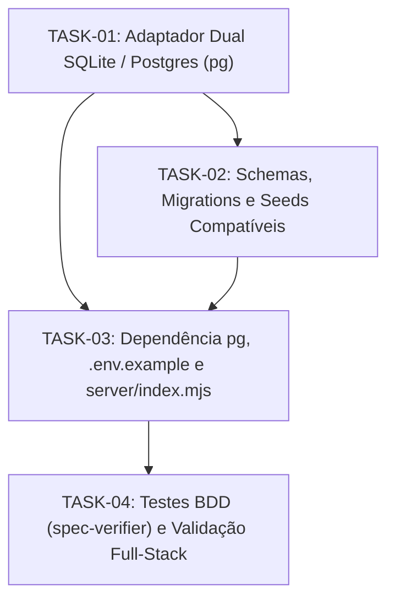

# Migração de Turso para Vercel Postgres (`Storage -> Neon/Postgres`) - Plano Técnico de Tarefas

- **Especificação:** `specs/vercel-postgres-storage.md`
- **Status Geral:** `pending`

## Grafo de Dependências

---

## Tarefas de Engenharia

### [TASK-01] Driver Postgres (`pg`) e conversor de placeholders no adaptador dual (`server/db/adapter.mjs`)
- **Camada:** `data_model`
- **Status:** `approved`
- **Depende de:** `Nenhuma`
- **Definição de Conclusão (DoD):**
  - Atualizar `server/db/adapter.mjs` removendo `@libsql/client` / `TURSO_*` e adicionando suporte ao driver `"postgres"` via `pg` (`Pool`, importação dinâmica + `createPgPool` injetável para testes).
  - `resolveDatabaseDriverConfig(env)` seleciona `"postgres"` quando `POSTGRES_URL` ou `DATABASE_URL` estiver definida (prioridade para `POSTGRES_URL`), e bloqueia `VERCEL === "1"` + `NODE_ENV === "production"` sem URL Postgres com `DatabaseAdapterError("POSTGRES_CONFIG_MISSING", ..., { status: 503 })` (`RF-01`, `RN-01`).
  - Implementar `convertPlaceholdersToPostgres(sql)` convertendo `?` fora de literais string `'...'` (preservando `''` escapado) para `$1, $2, ...` (`RF-01`).
  - Implementar `wrapPostgresPool(pool)` com `exec`, `get`, `all`, `run` (`changes: Number(res.rowCount ?? 0)`), `transaction` (`pool.connect()`, `BEGIN`/`COMMIT`/`ROLLBACK` + `client.release()` no `finally`), `close` (`pool.end()`), mapeamento de erros de rede/conexão para `POSTGRES_CONNECTION_ERROR` (`503`) preservando códigos de domínio SQL (`23505`, `23503`, `23502`, `22P02`, `SQLITE_CONSTRAINT`) (`RN-02`, `RN-03`).
  - Atualizar `server/db/adapter.test.mjs` cobrindo `POSTGRES_URL`/`DATABASE_URL`, trava `POSTGRES_CONFIG_MISSING` `503`, `convertPlaceholdersToPostgres`, transações Postgres mockadas e `503` vs `23505`.
- **Notas de Revisão:** Nenhuma

### [TASK-02] Compatibilidade de Schema, Migrations e Seeds entre SQLite e Postgres
- **Camada:** `service`
- **Status:** `approved`
- **Depende de:** `TASK-01`
- **Definição de Conclusão (DoD):**
  - Atualizar `server/auth/db.mjs`: remover `COLLATE NOCASE` no schema Postgres mantendo índice único funcional `idx_users_email_lower` (`LOWER(email)`), substituir `INSERT OR IGNORE INTO users` por `INSERT INTO users ... ON CONFLICT DO NOTHING`, e usar `WHERE LOWER(email) = LOWER(?)` em `promoteConfiguredAdmin` (`RF-02`).
  - Atualizar `server/dashboard/db.mjs`: schema Postgres com `DOUBLE PRECISION` e índice único funcional `idx_catalog_services_name_lower` (`LOWER(name)`), `INSERT INTO ... ON CONFLICT DO NOTHING` nos seeds, e `ensureColumnExists` usando `ALTER TABLE ... ADD COLUMN IF NOT EXISTS` quando `adapter.driver === "postgres"` (`RF-02`).
  - Preservar integralmente `node:sqlite` (`:memory:` e `./data/torquelab.sqlite`) (`RF-03`).
- **Notas de Revisão:** Nenhuma

### [TASK-03] Dependência `pg`, `.env.example` e injeção em `server/index.mjs`
- **Camada:** `config`
- **Status:** `approved`
- **Depende de:** `TASK-01`, `TASK-02`
- **Definição de Conclusão (DoD):**
  - Substituir `@libsql/client` por `"pg": "^8.13.0"` em `package.json` (mantendo `npm run test:*` funcionais offline).
  - Atualizar `.env.example` removendo `TURSO_*` e documentando `POSTGRES_URL=` / `DATABASE_URL=` sem prefixo `EXPO_PUBLIC_` (`RN-04`).
  - Atualizar `server/index.mjs` substituindo parâmetro `createLibsqlClient` por `createPgPool` e garantindo mapeamento de `DatabaseAdapterError` para HTTP `503`.
- **Notas de Revisão:** Nenhuma

### [TASK-04] Testes de aceitação BDD (`spec-verifier`) e validação completa
- **Camada:** `test`
- **Status:** `in_progress`
- **Depende de:** `TASK-03`
- **Definição de Conclusão (DoD):**
  - Atualizar `server/vercel.test.mjs` cobrindo os Cenários 1–5 de `specs/vercel-postgres-storage.md` (incluindo mock de `pg.Pool` sobre `:memory:` validando *cold start* idempotente, `23505` -> `409`, `ECONNREFUSED` -> `503` e `VERCEL=1` sem Postgres -> `503`).
  - Executar `npm run test:api`, `npm run test:auth`, `npm run test:dashboard`, `npm run test:admin`, `npm run test:preventive`, `npx tsc --noEmit` e `npm run lint` com `0` erros.
- **Notas de Revisão:** Nenhuma
